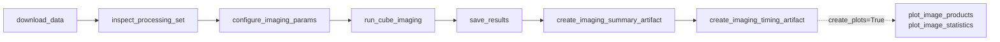

# Workflow integration test: single-field cube imaging

This document describes the integration tests in
[`test_workflow_single_field_cube_imaging.py`](test_workflow_single_field_cube_imaging.py).
It covers what each test checks, what the tests cover and leave out, and how
they use Prefect.

## Purpose

The tests run flowviper's Prefect workflow `single_field_cube_imaging_flow`
(module `flowviper.prefect_workflow.single_field_cube_imaging_example`) from
start to finish on real ALMA data, with the same components a user would have
installed. Each test calls the flow the way a user would. It then checks:

- the image the flow writes,
- the imaging configuration the flow saves, and
- the deconvolution summary that astroviper returns through the flow.

The tests check that the workflow layer works. They confirm that every flow
parameter reaches astroviper unchanged, that the tasks run and finish, and
that the outputs have the expected shape and basic properties. They do not
check that astroviper's images are numerically correct; astroviper's own tests
cover that.

## Software and data

| Item | Value |
|---|---|
| Workflow | `single_field_cube_imaging_flow` in flowviper |
| Imaging | astroviper `image_cube_single_field` (0.0.44 or later) |
| Orchestration | Prefect 3 |
| Input data | `twhya_selfcal_5chans_lsrk_compare_weights.ps.zarr` (TW Hya, 5 channels, linear feeds with the XX and YY correlations only), downloaded with toolviper |
| Installation | `requirements/main.txt` installs flowviper from `external/flowviper`, which brings astroviper and the other components with it |

## How a test runs

1. **Input data (once per session).** The session fixture
   `twhya_processing_set` downloads the processing set with toolviper into a
   temporary directory, opens it to count its frequency channels, and deletes
   it at the end of the session. If a store with the same name exists in the
   working directory, it is removed first, so every session starts from a
   fresh download.
2. **Flow run.** `_run_imaging` merges the case's overrides into the shared
   parameters (`BASE_PARAMS`). It then calls `single_field_cube_imaging_flow`
   with the image written to the test's own `tmp_path`, a Dask cluster of 2
   cores and a 4 GB memory limit.
3. **Checks.** The test inspects the flow's return value, the image store and
   the saved configuration (see [Checks](#checks-applied-to-each-run)).
4. **Cleanup.** The autouse fixture `cleanup_test_outputs` deletes the test's
   `tmp_path`, which removes the image store and the saved configuration.

### Shared flow parameters

Every case starts from these values and changes only the ones it is about:

| Parameter | Value |
|---|---|
| `image_size` | (250, 250) |
| `cell_arcsec` | 0.13 |
| `polarization_coords` | `["I", "Q"]` |
| `weighting`, `robust` | `"briggs"`, 0.5 |
| `algorithm` | `"hogbom"` |
| `gain` | 0.1 |
| `max_iter` | 100 |
| `threshold` | 0.0 |
| `max_cycles` | -1 (no limit) |
| `psf_sidelobe_factor` | 1.5 |
| `max_iter_per_cycle` | -1 (adaptive) |
| `min_psf_fraction`, `max_psf_fraction` | 0.05, 0.8 |

All other flow parameters keep the flow's defaults.

## Test cases

There are 14 tests in total.

### `test_single_field_cube_imaging_flow_e2e` (11 cases)

Each case runs the flow once with the overrides shown and applies every check
in [Checks applied to each run](#checks-applied-to-each-run).

| Case | Overrides | What it covers |
|---|---|---|
| `default-briggs` | None | The shared parameters: Briggs weighting, robust 0.5 |
| `natural-weighting` | `weighting="natural"` | Natural weighting reaches astroviper |
| `briggs-uniform` | `robust=-2.0` | Briggs at the uniform end |
| `briggs-robust-plus2` | `robust=2.0` | Briggs at the natural end |
| `low-gain-deep-clean` | `gain=0.05`, `max_iter=300` | A lower loop gain and a larger iteration budget |
| `short-minor-cycles` | `max_iter=20`, `max_iter_per_cycle=5` | A fixed per-cycle iteration limit; no cycle may run more than 5 iterations |
| `threshold-stop` | `threshold=0.2`, `max_iter=1000` | Stopping on the threshold: at least one plane stops before `max_iter`, with its final peak residual at or below the threshold (10% margin) |
| `small-coarse-cell` | `image_size=(128, 128)`, `cell_arcsec=0.26` | A different image size and cell size |
| `rectangular-image` | `image_size=(300, 200)` | A non-square image; `l` and `m` sizes must not be swapped |
| `create-plots` | `create_plots=True`, `plot_frequency_index=0` | The optional plotting steps run without error |
| `dirty-image-only` | `max_iter=0`, `max_cycles=0` | No deconvolution: every plane has zero iterations, and the image store is still complete |

### `test_natural_weighting_gives_wider_beam_than_uniform`

This test runs the flow twice with `max_iter=10`: once with natural weighting
and once with Briggs `robust=-2.0` (uniform). It reads the fitted PSF major
axis (`BEAM_FIT_PARAMS_POINT_SPREAD_FUNCTION`) of Stokes I in each image.
For every channel, the natural-weighted beam must be finite and wider than the
uniform one. This checks that the weighting setting changes the result in the
expected direction, not just that it is saved.

### `test_unsupported_stokes_selection_fails` (2 cases)

The TW Hya data holds only the XX and YY correlations. These cases ask for
Stokes selections that astroviper cannot make from that data. They check that
the error reaches the caller as a `ValueError`, rather than being swallowed by
the workflow.

| Case | `polarization_coords` | Expected error |
|---|---|---|
| `stokes-I-only` | `["I"]` | Message contains "not supported" (a linear-feed image needs `["I", "Q"]` or all four Stokes) |
| `full-stokes` | `["I", "Q", "U", "V"]` | Message contains "missing" (the XY and YX correlations are not in the data) |

## Checks applied to each run

Every `test_single_field_cube_imaging_flow_e2e` case applies these checks.

### Flow return value

The flow returns astroviper's result dictionary. It must contain
`deconvolution`, `image_statistics` and `timing_distributed_application`.

### Image store (`_assert_image_store`)

| Check | What it shows |
|---|---|
| The image store exists | The imaging task wrote its output |
| Every variable in the flow's default keep list is present (`SKY_RESIDUAL`, `SKY_MODEL`, `MASK`, `POINT_SPREAD_FUNCTION`, `PRIMARY_BEAM`, `BEAM_FIT_PARAMS_POINT_SPREAD_FUNCTION`) | The keep list was passed through |
| `l` and `m` sizes equal `image_size` | The image geometry was passed through |
| The number of frequency channels equals that of the input data | Every channel was imaged |
| The polarization coordinates equal `polarization_coords` | The Stokes selection was passed through |
| The PSF is finite everywhere and peaks at 1 (within 1e-3) | The PSF is valid and normalized |
| The residual image is finite everywhere | No channel failed or was left unwritten |

### Saved configuration (`_assert_saved_config`)

The flow's `save_results` task writes the configuration it built to
`<image_name>_imaging_results.pkl`. The test loads that file and compares it
with the parameters it passed:

| Saved entry | Expected value |
|---|---|
| `image_params.image_size`, `polarization_coords` | As passed |
| `image_params.cell_size` | `cell_arcsec` converted to radians, as `[-cell, +cell]` |
| `image_params.fft_padding` | 1.2 (flow default) |
| `imaging_weights_params` | `weighting` and `robust` as passed, `casa_weighting_implementation=False` |
| `gridder`, `gridding_kernel_params` | `"anti_alias"`, `None` (astroviper's defaults) |
| `algorithm` | As passed |
| `cycle_control_params` | `gain`, `max_iter`, `threshold`, `max_cycles`, `psf_sidelobe_factor`, `max_iter_per_cycle`, `min_psf_fraction` and `max_psf_fraction` as passed; `primary_beam_limit=0.2` (flow default) |

This is the check that catches a flow parameter that is dropped, renamed or
changed on its way to astroviper.

### Deconvolution summary (`_assert_deconvolution`)

The test converts the returned `deconvolution` record into one row per image
plane (channel × polarization) with `imaging_dict_to_dataframe`.

| Check | Applies when |
|---|---|
| There is one row per channel and polarization | Always |
| No plane exceeds `max_iter` iterations in total | Always |
| No cycle runs more than `max_iter_per_cycle` iterations | `max_iter_per_cycle > 0` |
| Every plane has zero iterations; no further checks | `max_iter == 0` |
| At least one plane was deconvolved | `max_iter > 0` |
| CLEAN lowered the peak residual of every deconvolved plane | `max_iter > 0` |
| The sky model is not all zero | `max_iter > 0` |
| At least one plane stopped before `max_iter`, with its final peak residual at or below 1.1 × `threshold` | `threshold > 0` |

## Use of Prefect

### The test harness

The tests run the flow against a temporary Prefect server, not a real
deployment. The session-scoped, autouse fixture `prefect_test_fixture` in
[`tests/integration/conftest.py`](conftest.py) wraps the whole pytest session
in Prefect's `prefect_test_harness()`. On entry, the harness:

1. creates a temporary directory with a new SQLite database,
2. starts a Prefect API server in a subprocess, using that database, and
3. points `PREFECT_API_URL` at that server for the rest of the session.

On exit, it stops the server, and the temporary database is deleted when
Python exits. The tests therefore need no Prefect server, worker, work pool or
deployment, and they never touch a user's own Prefect setup. Because the
fixture is in the top-level integration `conftest.py`, every integration test
shares one harness per session.

### Where things run

| Piece | Where it runs |
|---|---|
| pytest, fixtures and checks | pytest process |
| The flow and its tasks | pytest process: the flow is called as a normal Python function, and its tasks run one after another in the order the flow calls them |
| Prefect API and database | Harness subprocess, with SQLite in a temporary directory |
| Imaging | A local Dask cluster that the `run_cube_imaging` task starts with toolviper (2 cores, 4 GB in these tests) and closes when imaging ends |

### Tasks in one flow run



- `download_data` returns at once, because the fixture has already staged the
  data at the path the test passes.
- `inspect_processing_set` reads the phase centre and frequency axis.
  `configure_imaging_params` builds the configuration from them and from the
  flow parameters.
- `run_cube_imaging` calls astroviper's `image_cube_single_field` on the Dask
  cluster.
- `save_results` writes the `.pkl` file that the configuration check reads.
- The two artifact tasks publish Markdown reports (deconvolution summary and
  timing) to the Prefect server. In the `create-plots` case, the plotting
  steps also publish PNG image artifacts.
- `interactive=False` (the default) skips the pause for Prefect UI input
  (`modify_imaging_params`).

### What Prefect records, and what the tests use

During each run, Prefect records the flow run, every task run with its states
and logs, and the artifacts on the temporary server. The tests use Prefect in
two ways:

- **Normal completion.** Called directly, the flow returns the value of its
  last statement: astroviper's result dictionary. The tests check that value
  and the files the tasks wrote.
- **Failure.** If a task raises, Prefect marks the task run and the flow run
  as `Failed` and raises the original exception again in the caller.
  `test_unsupported_stokes_selection_fails` relies on this. It expects the
  `ValueError` raised inside `run_cube_imaging` to reach pytest unchanged.
  The other tests would fail with that exception and its traceback.

The tests do not read the run record back from the Prefect server: task-run
states, logs and artifacts are not asserted.

## What is not covered

- **Numerical correctness of the images.** There is no comparison with
  reference images or expected values. The checks are structural (shapes,
  coordinates, finiteness, PSF peak) and qualitative (CLEAN lowers the
  residual, natural beam wider than uniform).
- **The Prefect run record.** Task-run states, the order of tasks, logs and
  artifact contents are not checked.
- **Flow parameters left at their defaults:** `algorithm` other than
  `"hogbom"`, `gridder`, `gridding_kernel_params`, `fft_padding`,
  `primary_beam_limit`, `casa_weighting_implementation`,
  `image_data_variables_keep`, `single_precision_image`,
  `processing_function_threads`, `n_mapping_parallelism`, `restore`,
  `fft_backend` and `write_visibility_model_to_ps`. Their default values are
  checked in the saved configuration, but no case changes them.
- **Interactive mode** (`interactive=True`), which pauses for input in the
  Prefect UI.
- **The Google Drive download path** of `download_data`, and the Cloudflare
  download inside the flow (the fixture downloads the data before the flow
  runs).

## Running the tests

From the repository root, with the environment built from
`requirements/main.txt`:

```bash
# All single-field workflow tests
pytest -v tests/integration/test_workflow_single_field_cube_imaging.py

# One case
pytest -v "tests/integration/test_workflow_single_field_cube_imaging.py::test_single_field_cube_imaging_flow_e2e[threshold-stop]"
```

All 14 tests take about 45 seconds on a laptop, plus the one-time download of
the input data. The `timeout` markers (1800 s for imaging runs, 600 s for the
Stokes error cases) are enforced by `pytest-timeout`.
